# INFINITY X - Sistema de tienda de tecnología - POO

Programa en C++ hecho para la materia. Es un sistema en consola para administrar una tienda de tecnología llamada INFINITY X: clientes, personal, inventario, abastecimiento, ventas y caja. Usa clases con herencia y polimorfismo, y guarda los datos en archivos para que no se pierdan al cerrar el programa.

> **Solo funciona en Windows**, porque usa `windows.h` y `conio.h` para dibujar la interfaz en la consola.

## Qué hace

- Pide usuario y clave antes de entrar al sistema.
- **Clientes**: registrar, consultar, actualizar, eliminar y mostrar todos (con paginación).
- **Personal administrativo**: lo mismo, pero con cargo y sueldo (Administrador, Vendedor, Cajero, Almacenero y Técnico de computadoras).
- **Abastecimiento de productos**: un trabajador registrado solicita productos al costo de abastecimiento (80% del precio de venta). Se descuenta del dinero del establecimiento y el stock sube al instante. Si no alcanza el dinero, no se hace.
- **Inventario**: muestra los productos por categoría con su stock, y el detalle de cada uno.
- **Pedidos**: un cliente registrado compra varios productos. Se puede pagar en efectivo (con vuelto) o con tarjeta (10% de descuento). Al pagar baja el stock, sube el dinero del establecimiento y se muestra el recibo.
- **Dinero del establecimiento**: muestra el saldo disponible (empieza en S/ 44,096.00).
- Valida los datos que se ingresan: DNI sin repetir, edad entre 1 y 120, celular solo con dígitos, montos válidos, stock suficiente, etc.

## Productos (20, en 5 categorías)

| Categoría | Productos |
|---|---|
| Computadoras | 2 laptops y 2 PC |
| Accesorios | mouse, audífonos, reloj, webcam y teclado |
| Componentes | procesador, memoria RAM, ventilador y GPU |
| Dispositivos móviles | 3 celulares y 1 tablet |
| Pantallas | 3 monitores |

## Menú principal

```
1. Clientes
2. Personal administrativo
3. Abastecimiento de productos
4. Inventario
5. Pedidos
6. Dinero del establecimiento
0. Salir
```

Para entrar usa el usuario `Admin` con la clave `12345`.

## Estructura de carpetas

```
proyecto-infinity-x/
├── src/
│   └── INFINITY_X.cpp
├── capturas/        (capturas de pantalla)
├── .gitignore
└── README.md
```

## Cómo compilar y correrlo

Solo en Windows, con MinGW:

```
g++ -o infinity_x.exe src/INFINITY_X.cpp
infinity_x.exe
```

Conviene ejecutarlo desde la consola de Windows (cmd), porque el programa cambia el tamaño y el color de la ventana.

## Cómo está hecho

**Productos (herencia y polimorfismo).** Todos los productos heredan de `ProductoTecnologico`, que guarda código, nombre, marca, gama, tamaño y precio. Cada clase hija agrega sus propias características y redefine el método virtual `caracteristicas()`, así el detalle de cualquier producto se muestra con la misma llamada:

```
ProductoTecnologico
├── Computadora ── Laptop, PC
├── Pantalla
├── DispositivoEntrada ── Mouse, Teclado
├── Audifonos
├── Reloj
├── Webcam
├── Componente ── Procesador, MemoriaRAM, Ventilador, GPU
└── DispositivoMovil ── Celular, Tablet
```

El catálogo es un arreglo de punteros a `ProductoTecnologico`, y se libera la memoria al salir.

**Personas.** `Persona` tiene los datos comunes (nombre, DNI, edad, celular y correo). `Cliente` agrega la dirección y `Trabajador` agrega el cargo y el sueldo.

**Operaciones genéricas.** Registrar, consultar, actualizar, eliminar y listar se hicieron una sola vez con plantillas (`template`) y funcionan tanto para clientes como para trabajadores.

**Archivos.** Los datos se guardan en archivos binarios que el programa crea solo en la primera ejecución: `clientes.dat`, `trabajadores.dat`, `inventario.dat` y `caja.dat`. La primera vez se cargan 2 clientes y 3 trabajadores de ejemplo.

**Pantalla.** Se dibuja con `gotoxy`, cuadros de caracteres y funciones propias para leer texto con tildes (UTF-8) y contraseñas con asteriscos.

## Cosas a tener en cuenta

- Máximo 200 clientes y 200 trabajadores.
- El usuario y la clave están escritos directamente en el código.
- Los archivos `.dat` no se suben al repositorio (están en el `.gitignore`); se generan al ejecutar.

## Capturas

Aquí van las pantallas principales. En la carpeta `capturas/` están las 43 imágenes del recorrido completo, numeradas en orden.

**Menú principal**

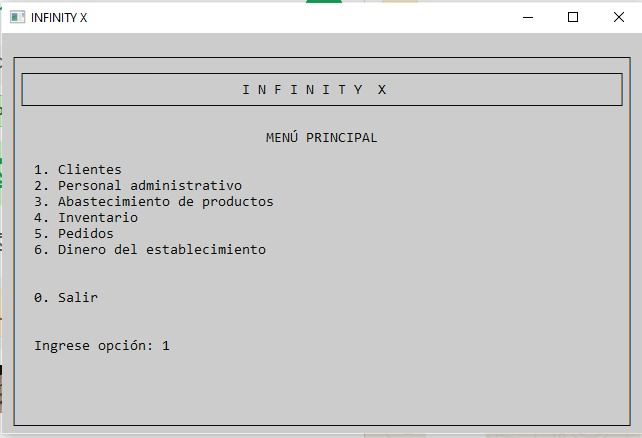

**Clientes: registrar**

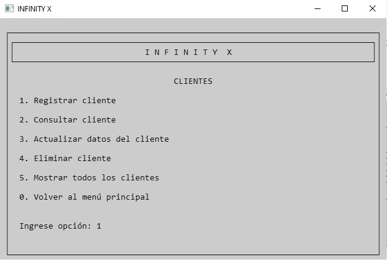

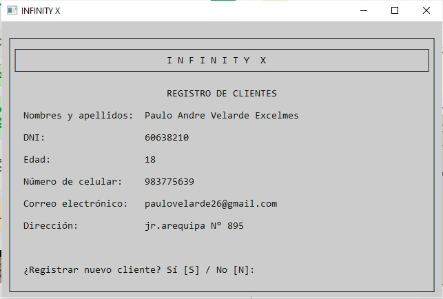

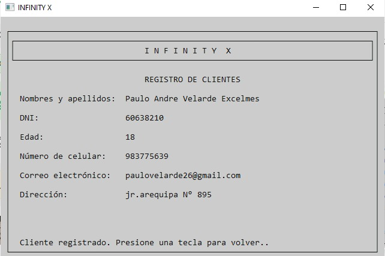

**Clientes: consultar, actualizar y eliminar**

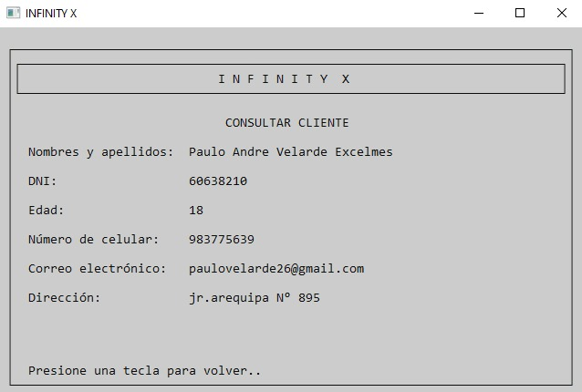

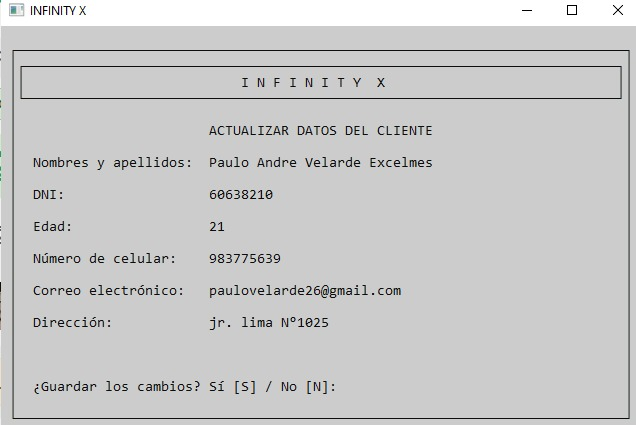

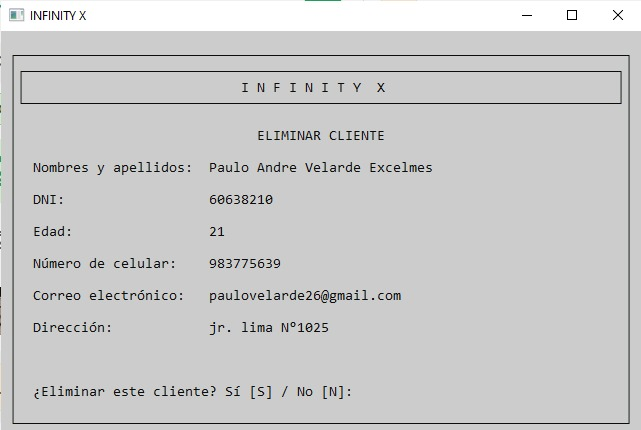

**Clientes: mostrar todos**

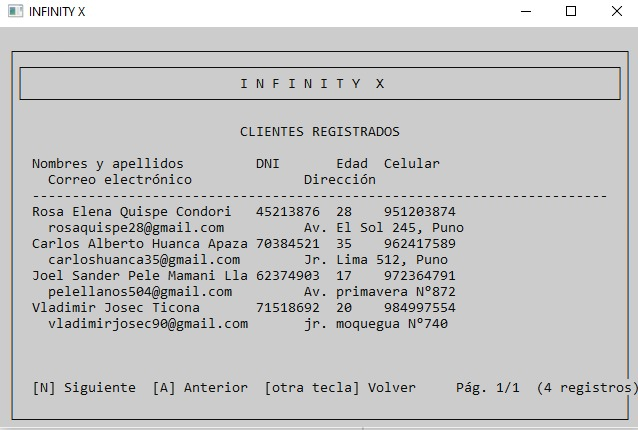

**Personal administrativo: registrar trabajador**

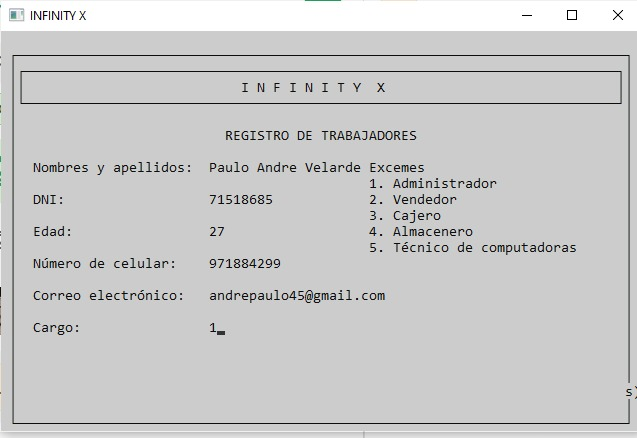

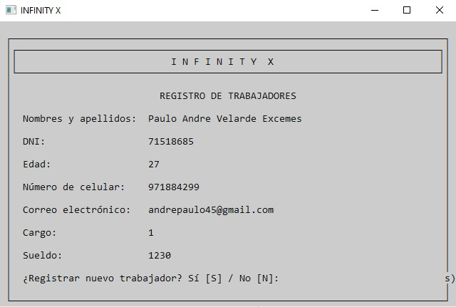

**Abastecimiento de productos**

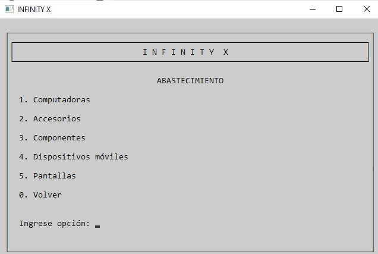

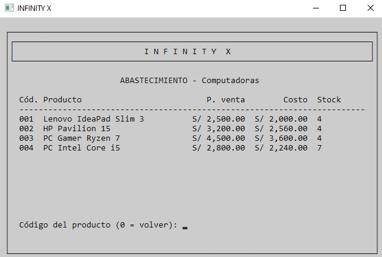

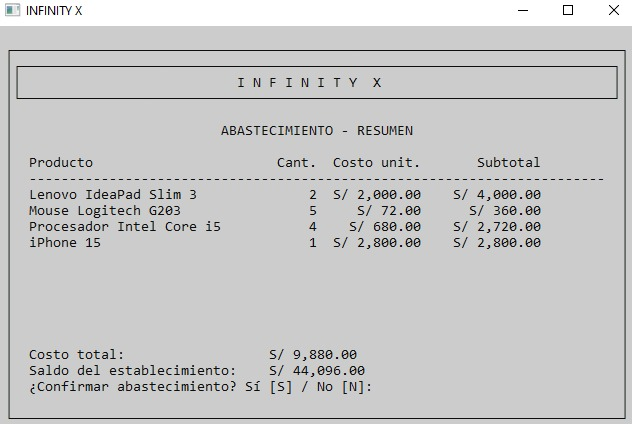

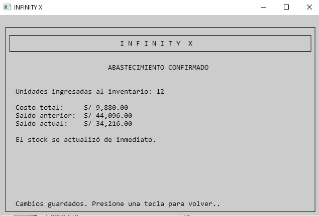

**Inventario**

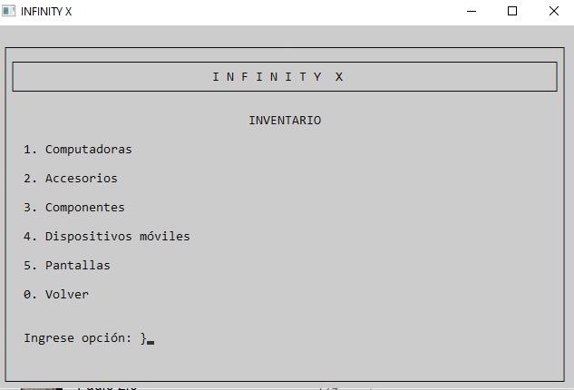

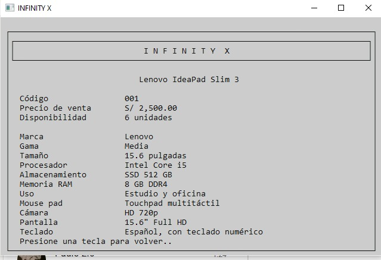

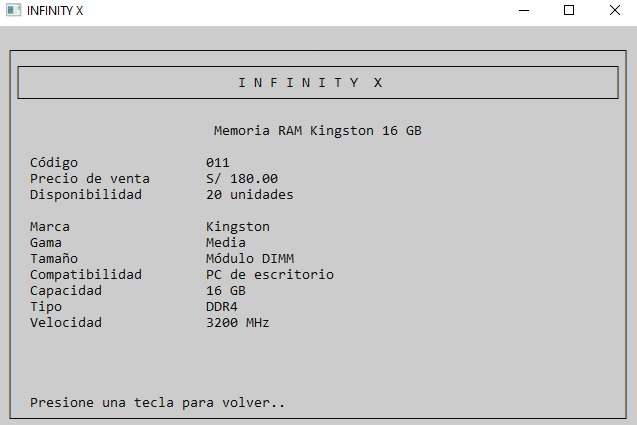

**Pedidos: compra, pago y recibo**

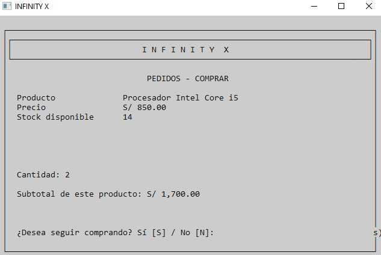

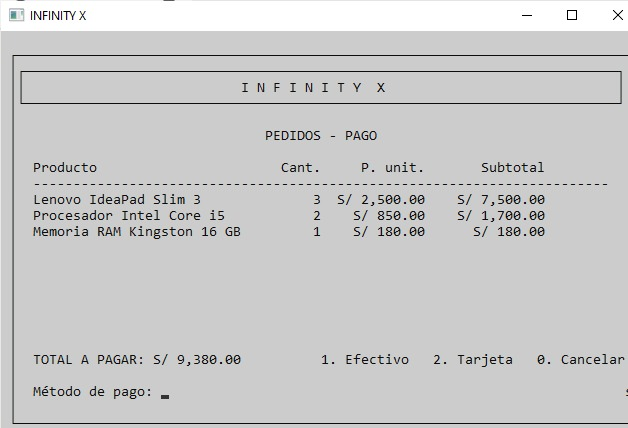

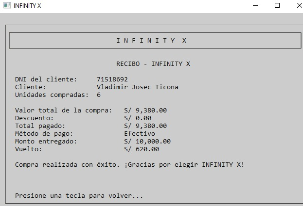

**Dinero del establecimiento**

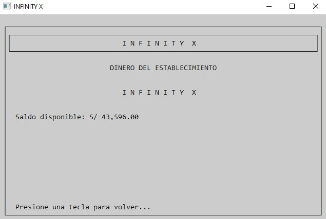

**Salir**

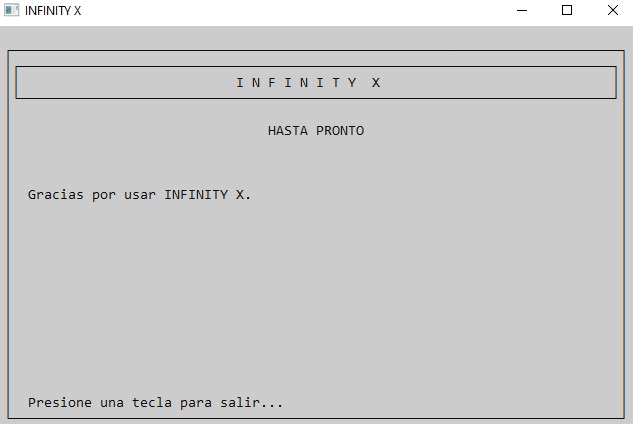

## Autores

- Josec Ticona Vladimir
- Mamani Llanos Joel Sander Pele
- Velarde Excelmes Paulo Andre
